# Saints Gym Management System

A Flask and SQLite-based gym management application developed as a software portfolio project.

**Author:** John Genes Robert Tragua  
**Role:** Computer Engineer

---

## 1. Project Overview and Features

Saints Gym Management System provides a web-based interface for common gym check-in and staff administration workflows. It is built with Flask, SQLite, HTML, CSS, and JavaScript, with responsive pages for desktop and mobile use.

### Features

- Staff login and administrative dashboard
- Member registration and member management
- Member and guest check-in/check-out workflows
- Attendance history with search, date filtering, and sorting
- Dashboard attendance summaries and reporting
- Staff account recovery and settings workflows
- Notifications for pending membership registration requests
- Customer check-in QR-code page
- Responsive, phone-oriented customer pages
- SQLite database integration

---

## 2. Technology Stack

- **Python** — application logic
- **Flask** — web application framework
- **SQLite** — local relational database
- **HTML** — page structure
- **CSS** — layout and styling
- **JavaScript** — browser-side interactions
- **Waitress** — local serving through the included server launcher
- **Gunicorn configuration** — included for supported hosting environments

---

## 3. Screenshot Gallery

The screenshots below are stored in the repository's `screenshots/` folder. The image paths use the actual filenames in that folder.

### Customer pages

| Home page | Guest check-in |
|---|---|
| 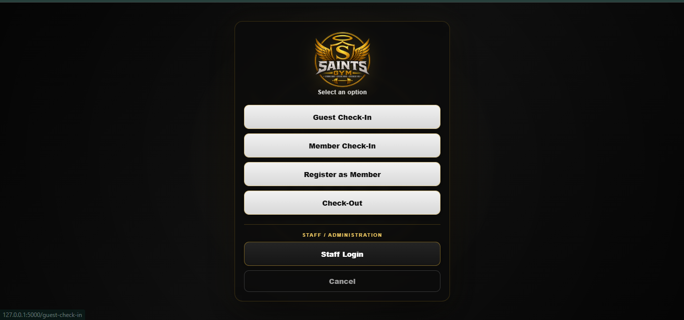 | 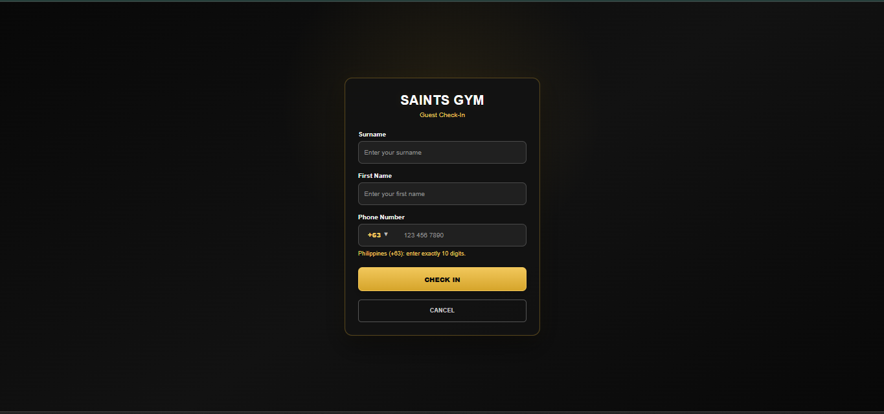 |

| Member check-in | Member registration |
|---|---|
| 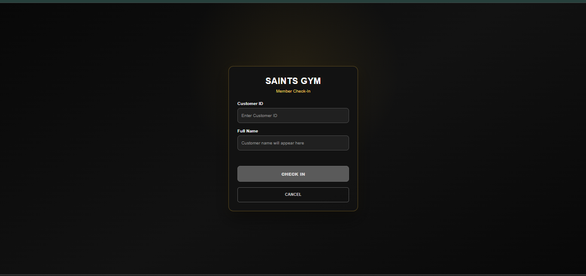 | 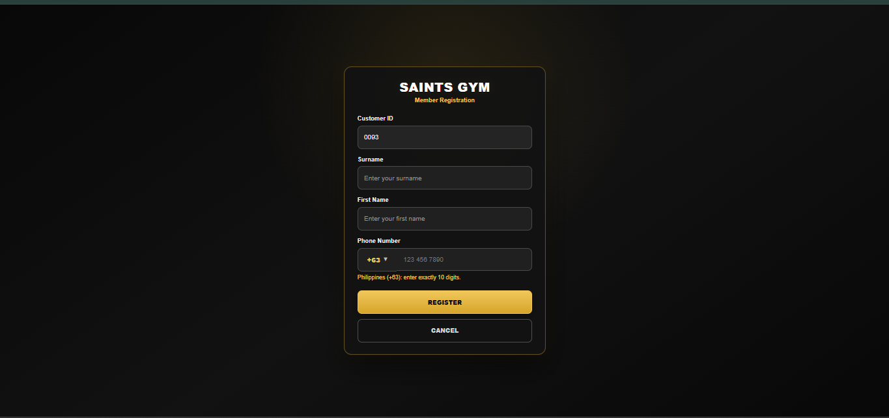 |

| Check-out options | Member check-out |
|---|---|
| 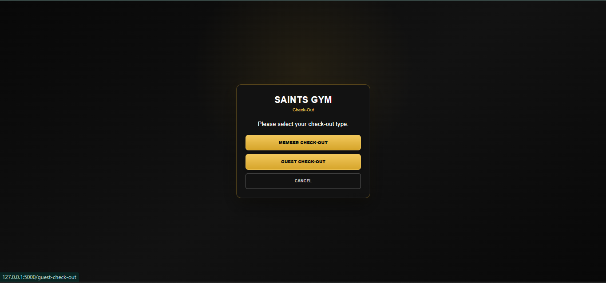 | 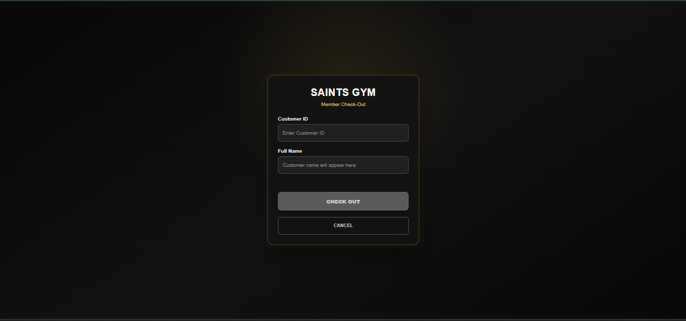 |

| Guest check-out | Staff login |
|---|---|
| 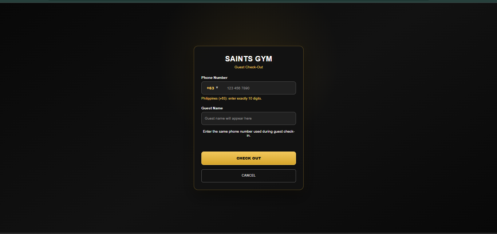 | 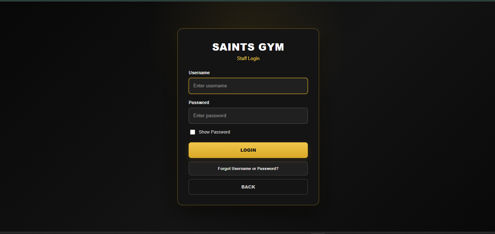 |

### Staff administration

| Dashboard | Attendance history |
|---|---|
| 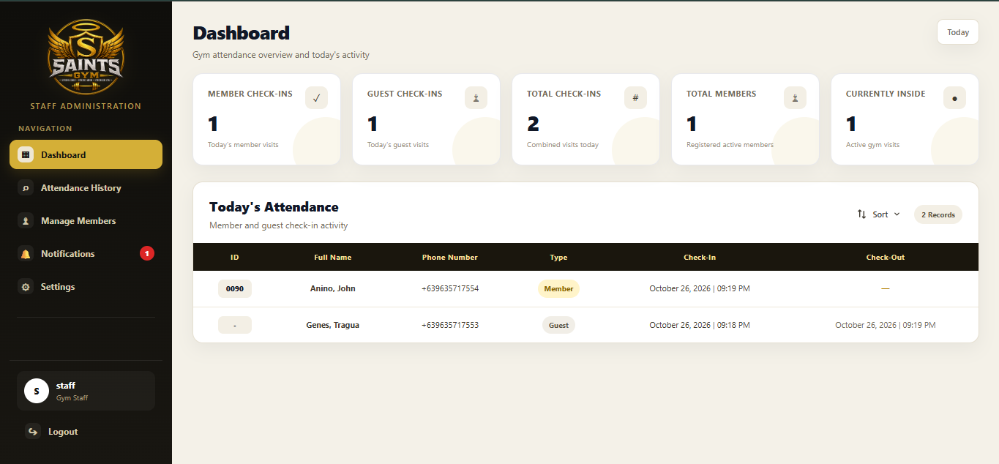 | 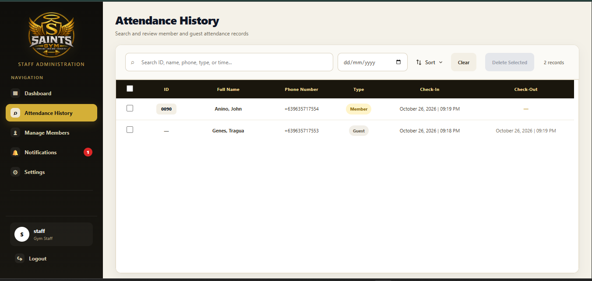 |

| Manage members | Notifications |
|---|---|
| 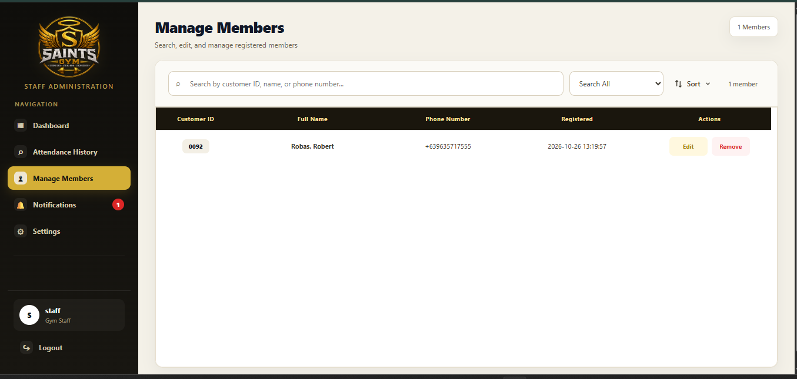 | 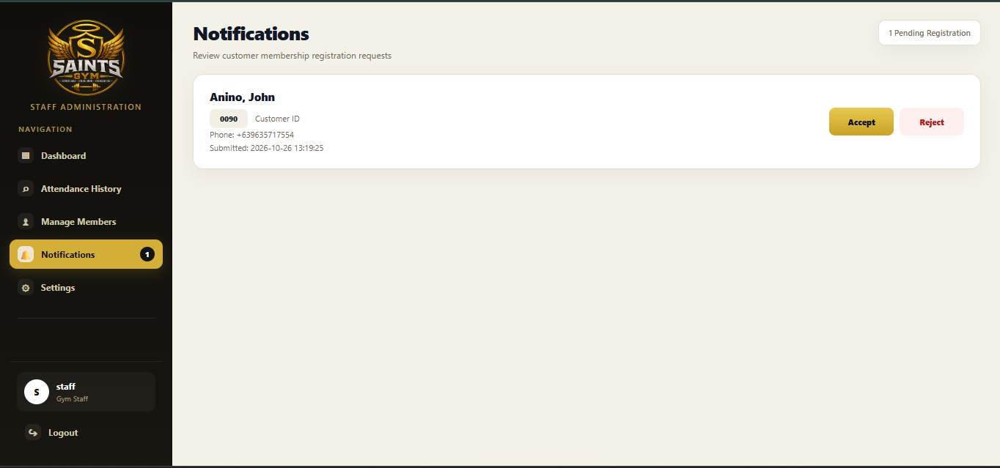 |

| Settings |
|---|
| 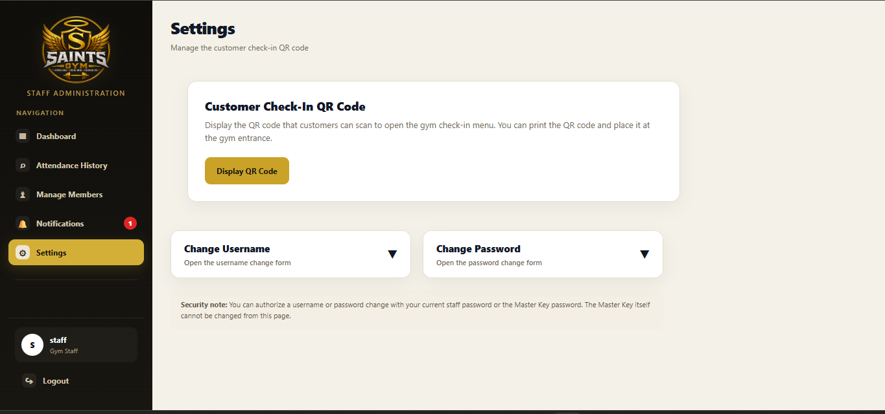 |

---

## 4. Installation and Setup

### Requirements

- Python 3.10 or newer
- Git (optional, for cloning the repository)

### Windows setup

1. Clone or download this repository.
2. Open a terminal in the project folder.
3. Create a virtual environment:

   ```bash
   python -m venv .venv
   ```

4. Activate the environment.

   **PowerShell:**
   ```powershell
   .\.venv\Scripts\Activate.ps1
   ```

   **Command Prompt:**
   ```bat
   .\.venv\Scripts\activate
   ```

5. Install dependencies:

   ```bash
   pip install -r requirements.txt
   ```

6. Copy `.env.example` to `.env` and replace all placeholders with private values. See the environment configuration section below. Never upload `.env`.
7. Start the local server:

   ```bash
   python run_server.py
   ```

8. Open `http://127.0.0.1:5000` in your browser.

The application uses the database path configured by `SAINTS_DATABASE_PATH`. If that variable is not set, it uses `gym.db` in the project directory. The database file is intentionally not included in this public repository; the application may create a local database when it starts.

---

## 5. Environment Configuration and Security Notes

Use `.env.example` as a template for local development. Create your own private `.env` file and replace every placeholder before starting the application.

Configuration variables include:

- `FLASK_SECRET_KEY` — a long, randomly generated secret used to protect Flask sessions
- `SAINTS_MASTER_USERNAME` — private master/owner username
- `SAINTS_MASTER_PASSWORD` — private master/owner password
- `SAINTS_HOST` — server bind address
- `SAINTS_PORT` — server port
- `SAINTS_THREADS` — Waitress worker-thread setting
- `SAINTS_DATABASE_PATH` — optional path to the local SQLite database

Security reminders:

- Never commit `.env`, real credentials, secret keys, customer records, database files, backups, or production configuration.
- Keep `.env.example` limited to placeholder values.
- Use unique, strong private credentials for any local test instance.
- Do not reuse credentials from a deployed or client system.
- Review all screenshots before publishing to ensure they do not expose private information.
- This repository is a portfolio demonstration and has not been represented as a full independent security audit.

---

## 6. Portfolio and Privacy Disclaimer

This public repository is intended to demonstrate software development work. It does not include the operational SQLite database or a real `.env` file. Use fictional test data and private credentials when running the application locally.

Before sharing or reusing the application, confirm that you have permission to publish the source code and any included branding or assets. Do not upload client records, private keys, production credentials, or other confidential information.

---

## 7. Author

**Made by:** John Genes Robert Tragua  
**Profession:** Computer Engineer
